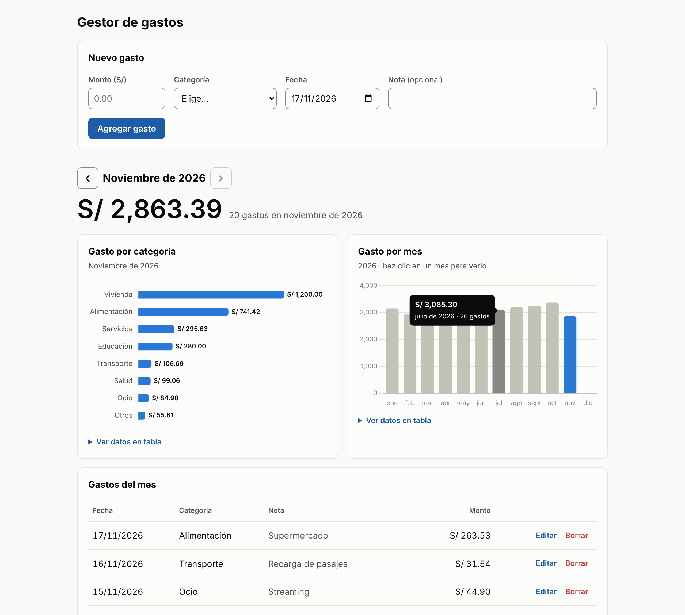
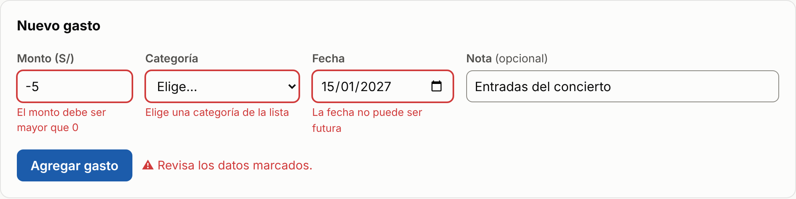
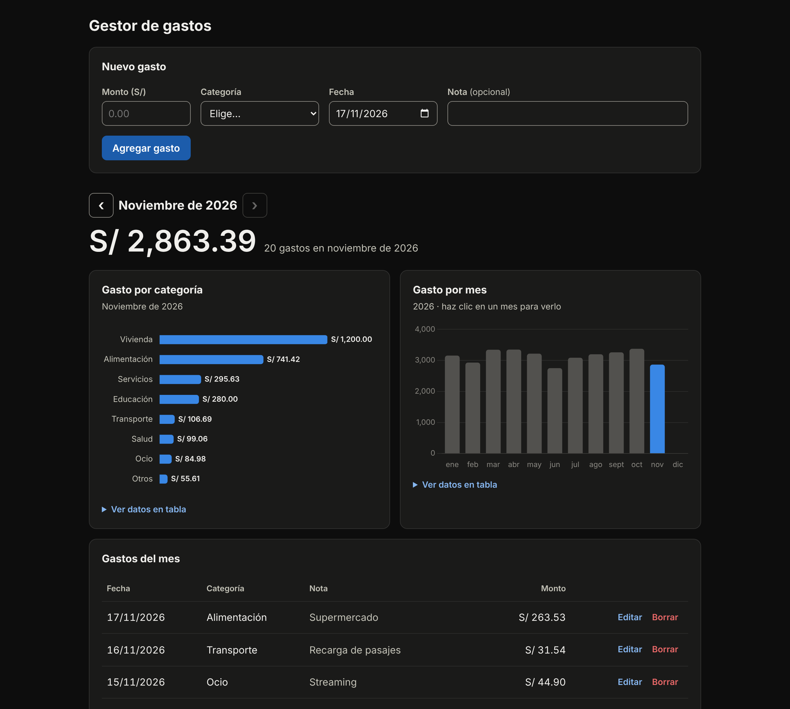

# Gestor de gastos

Aplicación web local para llevar tus gastos personales: anotas cada gasto y ves en qué se va el dinero, por mes y por categoría.

**Stack:** Python · FastAPI · SQLite · HTML/JS sin framework · Chart.js



## Arranque rápido

Solo necesitas **Python 3.11 o superior**.

```bash
git clone https://github.com/DGO2022/Gestor-Gastos.git
```

```bash
cd Gestor-Gastos
```

```bash
python run.py
```

Abre <http://127.0.0.1:8000> en el navegador. Para detenerlo, `Ctrl+C`.

La primera vez tarda unos segundos: crea un entorno virtual (`.venv`) e instala las dependencias. Las siguientes arranca al instante.

> Si `python` no existe en tu equipo, usa `python3 run.py` (macOS/Linux) o `py run.py` (Windows).

## Qué hace

- **Registrar** gastos con monto, categoría, fecha y nota.
- **Editar y borrar** cualquier gasto (el borrado pide confirmación).
- **Total del mes** y navegación entre meses.
- **Gráfico por categoría:** en qué se fue el dinero del mes, de mayor a menor.
- **Gráfico por mes:** los 12 meses del año; al hacer clic en un mes, se muestra.
- **Validaciones en el backend**, con el mensaje de error bajo cada campo.
- Tema claro y oscuro (sigue al sistema) y diseño adaptado al móvil.
- Funciona **sin internet**: Chart.js va incluido en el repo.

## Capturas

Los errores de validación llegan del backend y se muestran en el formulario:



Tema oscuro:



## Opciones

| Qué | Cómo | Por defecto |
| --- | --- | --- |
| Puerto | `python run.py --puerto 8001` | `8000` |
| Símbolo de moneda | `python run.py --moneda "$"` | `S/` |
| Archivo de datos | variable de entorno `GASTOS_DB` | `gastos.db` en la carpeta del proyecto |

Las categorías y los límites de validación están en [`app/config.py`](app/config.py).

## Tus datos

Todo se guarda en un único archivo: **`gastos.db`**. Para hacer una copia de seguridad, copia ese archivo. No se sube al repo (está en `.gitignore`).

> **Seguridad:** la app no tiene usuarios ni contraseña, por eso solo escucha en `127.0.0.1` (tu propio equipo). No la publiques en internet tal como está.

## Validaciones

Se aplican siempre en el backend ([`app/esquemas.py`](app/esquemas.py)), se use la web o la API directamente:

| Campo | Regla |
| --- | --- |
| `monto` | Número mayor que 0, con 2 decimales como máximo y hasta 99,999,999.99 |
| `categoria` | Una de la lista: Alimentación, Transporte, Vivienda, Servicios, Salud, Educación, Ocio, Ropa, Otros |
| `fecha` | Formato `AAAA-MM-DD`, una fecha real, del año 2000 en adelante y nunca futura |
| `nota` | Opcional, hasta 200 caracteres (se quitan los espacios sobrantes) |

Si algo no cumple, la API responde `422` con un error por campo:

```json
{
  "detail": [
    { "campo": "monto", "mensaje": "El monto debe ser mayor que 0" },
    { "campo": "fecha", "mensaje": "La fecha no puede ser futura" }
  ]
}
```

## API

Documentación interactiva en <http://127.0.0.1:8000/docs> (necesita internet para cargar su interfaz).

| Método | Ruta | Qué hace |
| --- | --- | --- |
| `GET` | `/api/gastos?mes=AAAA-MM` | Lista los gastos, del más reciente al más antiguo (`mes` es opcional) |
| `POST` | `/api/gastos` | Crea un gasto |
| `GET` | `/api/gastos/{id}` | Devuelve un gasto |
| `PUT` | `/api/gastos/{id}` | Reemplaza un gasto |
| `DELETE` | `/api/gastos/{id}` | Borra un gasto |
| `GET` | `/api/resumen/mensual?anio=AAAA` | Total de cada uno de los 12 meses del año |
| `GET` | `/api/resumen/categorias?mes=AAAA-MM` | Total por categoría, de mayor a menor |
| `GET` | `/api/config` | Moneda, categorías y límites que usa la web |
| `GET` | `/api/salud` | Comprueba que el servidor responde |

Ejemplo:

```bash
curl -X POST http://127.0.0.1:8000/api/gastos -H "Content-Type: application/json" -d '{"monto": 25.50, "categoria": "Alimentación", "fecha": "2026-11-15", "nota": "Almuerzo"}'
```

## Tests

Con el entorno que creó `run.py`, instala las dependencias de desarrollo y ejecuta pytest.

macOS / Linux:

```bash
.venv/bin/python -m pip install -r requirements-dev.txt
```

```bash
.venv/bin/python -m pytest
```

Windows:

```powershell
.venv\Scripts\python -m pip install -r requirements-dev.txt
```

```powershell
.venv\Scripts\python -m pytest
```

Son 212 tests (unos 2 segundos) que cubren las reglas de validación, la API completa, los resúmenes, la base de datos y los archivos de la web. Cada test usa una base SQLite temporal: nunca tocan tus datos.

## Estructura

```text
run.py                  Arranque con un solo comando
requirements.txt        Dependencias para ejecutar
requirements-dev.txt    Dependencias para los tests
app/
  main.py               Rutas HTTP: la API y la página
  esquemas.py           Qué datos son válidos (validaciones)
  db.py                 SQLite: conexión, tabla y consultas
  config.py             Categorías, límites y ajustes
  static/               La web: index.html, estilos.css, app.js y Chart.js
tests/                  Tests con pytest
docs/                   Capturas de este README
```

## Decisiones técnicas

- **Dinero en céntimos enteros.** En coma flotante `0.1 + 0.2` no da `0.3`. Los montos se guardan y se suman como enteros, y solo se convierten a decimales al mostrarlos.
- **SQLite con el módulo estándar `sqlite3`, sin ORM.** Para una tabla y siete consultas, el SQL directo es más simple y no añade dependencias.
- **Categorías en lista cerrada.** Evita que "comida", "Comida" y "comidas" aparezcan como tres barras distintas en el gráfico.
- **Barras en lugar de gráfico de dona** para las categorías: con barras ordenadas se comparan mejor los montos, sobre todo los parecidos.
- **Las reglas viven solo en el backend.** La web no las repite: envía los datos y muestra los mensajes que recibe.
- **Las notas se pintan como texto, nunca como HTML**, y la página solo carga archivos de su propio servidor (CSP), para que una nota no pueda inyectar código.

## Ideas para seguir

- Exportar a CSV o Excel.
- Presupuesto mensual por categoría, con aviso al superarlo.
- Categorías personalizadas desde la web.
- Usuarios y contraseña, si algún día se quiere usar fuera del propio equipo.
